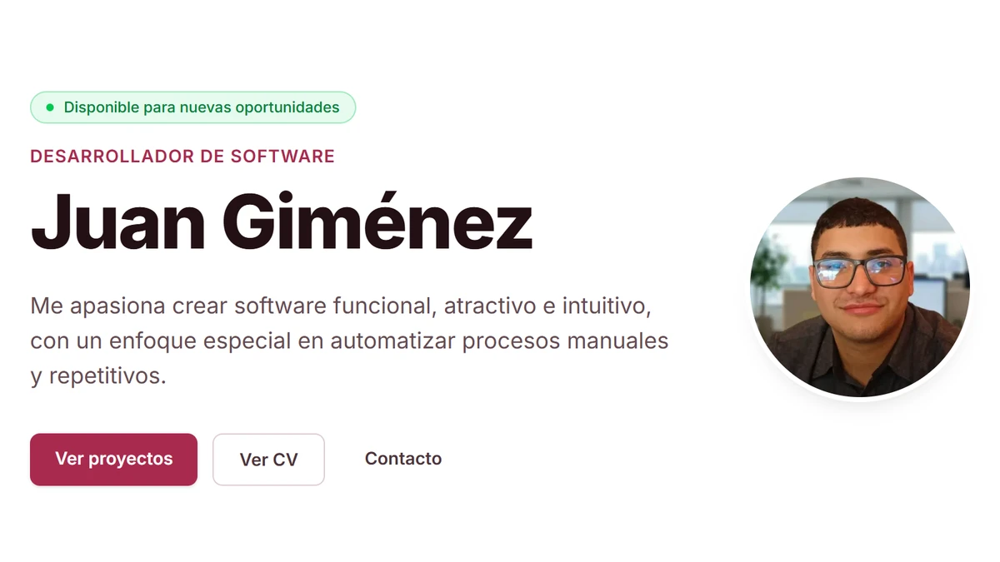

# jscalon.dev — Portfolio y CV

[](https://jscalon.dev)

**[jscalon.dev](https://jscalon.dev)** · [Caso de estudio de este sitio](https://jscalon.dev/es/projects/portfolio/)

Mi sitio personal: una alternativa al CV en PDF. Cuenta en detalle las aplicaciones que he
desarrollado —el problema, la solución, mi rol y capturas con datos de ejemplo— e incluye el
CV como una página más, generado a partir de los mismos datos que el resto del sitio.

## Decisiones que lo definen

- **Bilingüe por arquitectura, no por traducción.** Rutas por idioma (`/es/`, `/en/`), un
  único diccionario de textos de interfaz y cada caso de estudio en dos archivos que
  comparten identificador, así el selector de idioma lleva a la página equivalente.
- **El CV es una página, no un archivo.** Se genera desde los mismos datos que el resto del
  sitio, así que nunca queda desactualizado, y se exporta a PDF desde el navegador sobre
  reglas de impresión propias que lo dejan en una hoja A4.
- **Estático y liviano.** Astro genera HTML sin JavaScript por defecto: el sitio carga menos
  de 5 KB de JS, funciona aunque el script falle y respeta la preferencia de menos movimiento.
- **Imágenes procesadas en el build**, en AVIF y WebP a varios tamaños; el build falla si una
  ruta no existe.
- **Pruebas antes de publicar.** El build corre una suite de Vitest con las reglas que el
  tipado no ve —que cada proyecto exista en los dos idiomas, que no falten textos en inglés—,
  y si algo falla no se publica.
- **Analítica sin cookies**, así que no hay banner de consentimiento.

**Stack:** Astro 5 · TypeScript · Tailwind CSS 4 · Vitest · Netlify

---

## Desarrollo

```bash
pnpm install
pnpm dev       # http://localhost:4321  (abre /es/ o /en/)
pnpm build     # pruebas + astro check + build estático en dist/
pnpm preview   # sirve el build de dist/
```

Requiere Node 20+. Netlify publica en **jscalon.dev** con cada `push` a `main`
(configuración en `netlify.toml`).

## Cómo editar el contenido

| Qué | Dónde |
| --- | --- |
| Datos personales, contacto, experiencia, formación, skills, idiomas | `src/data/site.ts` |
| Textos de la interfaz (botones, títulos, navegación) | `src/i18n/ui.ts` |
| Proyectos | `src/content/projects/<es\|en>/<slug>.md` |
| CV | Se genera solo desde `src/data/site.ts` → `/es/cv`, `/en/cv` |
| Portadas de proyectos | `src/assets/covers/<slug>.webp` (1200×675) |
| Foto de perfil | `src/assets/profile.webp` (800×800) |
| Imagen social (Open Graph) | `public/og-image.png` (1200×630) |
| Favicon | `public/favicon.svg` |
| Colores / tipografía | `src/styles/global.css` (bloque `@theme`) |

Para añadir un proyecto se crean **dos** archivos con el mismo nombre, uno por idioma
(`src/content/projects/es/<slug>.md` y `src/content/projects/en/<slug>.md`). El esquema del
frontmatter está en `src/content.config.ts`.

`CONTENT_GUIDE.md` tiene la guía completa de edición de contenido, y `AGENTS.md`, las
convenciones técnicas y las decisiones de diseño.

---

**English** — My personal site and an alternative to the PDF CV: detailed case studies of the
applications I have built, plus the CV as a page generated from the same data. Bilingual by
architecture, static, under 5 KB of JavaScript, with tests that run before every deploy.
Built with Astro, TypeScript and Tailwind CSS. Live at **[jscalon.dev](https://jscalon.dev/en/)**.
